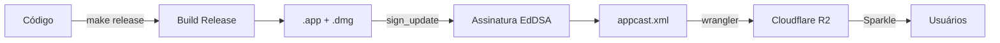

# Guia de Release — Fala

## Visão Geral

O Fala distribui atualizações fora da App Store usando **Sparkle** + **Cloudflare R2**.



### Componentes

| Componente | O que faz |
|---|---|
| `Info.plist` | Define a versão e a URL do feed |
| `appcast.xml` | Lista de versões disponíveis (hospedado no R2) |
| `Fala-X.Y.dmg` | O app empacotado (hospedado no R2) |
| `scripts/create-dmg.sh` | Monta o DMG com layout guiado, fundo customizado e atalho para `Applications` |
| EdDSA key | Par de chaves para assinar releases (no Keychain) |
| `scripts/release.sh` | Automatiza todo o fluxo |

---

## Versão mínima do macOS

As próximas compilações desta base exigem macOS 27.2.1 ou superior em Apple Silicon. `Package.swift` e `LSMinimumSystemVersion` devem concordar; o build usa o valor do plist e verifica o mínimo gravado no executável. A geração do appcast lê o mesmo plist para definir `sparkle:minimumSystemVersion`. Execute `python3 scripts/test-platform-policy.py` para conferir manifesto, plist, template do feed e suporte do compilador ao mínimo com patch.

A distribuição já publicada do Fala 1.14 (35) mantém seus artefatos e metadados originais. Esta política vale para compilações posteriores; não autoriza sobrescrever instaladores ou feeds anteriores. O mínimo declarado não comprova execução em todas as versões posteriores do macOS.

## Versionamento

Seguimos [Semantic Versioning](https://semver.org/) simplificado:

```
CFBundleShortVersionString = "1.2"    ← o que o usuário vê
CFBundleVersion            = "5"      ← build number (sempre incrementa)
```

| Quando | Exemplo |
|---|---|
| Correção de bug | 1.0 → 1.0.1 (build 2) |
| Nova funcionalidade | 1.0 → 1.1 (build 3) |
| Mudança grande / breaking | 1.x → 2.0 (build N) |

> **Regra de ouro**: o `CFBundleVersion` (build) **sempre sobe**, nunca repete.

---

## Como Publicar uma Release

Um único comando faz tudo:

```bash
make release BUMP=patch    # 1.0 → 1.0.1 (bug fix)
make release BUMP=minor    # 1.0 → 1.1   (nova feature)
make release BUMP=major    # 1.0 → 2.0   (breaking change)
```

O script automaticamente:
1. Verifica que a working tree está limpa.
2. Verifica chave EdDSA e `wrangler`.
3. Atualiza versão e build em `Info.plist`.
4. Cria commit e tag `vX.Y`.
5. Gera o build otimizado de release.
6. Cria `.app` e `.dmg` com fundo guiado de instalacao e janela pronta para arrastar.
7. Assina o artefato com EdDSA.
8. Gera e publica `appcast.xml` e `.dmg` no R2.
9. Faz push do commit e da tag.

### Testar sem publicar

```bash
make release-dry BUMP=patch
```

Faz tudo localmente mas **não faz upload** e **reverte** o commit/tag automaticamente.

---

## Onde Cada Coisa Mora

```
Fala/
├── Sources/Fala/Resources/
│   └── Info.plist              ← versão + SUFeedURL + SUPublicEDKey
├── scripts/
│   └── release.sh              ← script de publicação
├── Makefile                     ← make release / make release-dry
└── .build/artifacts/sparkle/Sparkle/bin/
    ├── generate_keys            ← gerar par de chaves EdDSA
    ├── sign_update              ← assinar um .dmg
    └── generate_appcast         ← gerar appcast (não usamos, o script gera)

Cloudflare R2 (bucket: fala-updates)
├── appcast.xml                  ← feed de atualizações
├── Fala-1.0.dmg                 ← releases
├── Fala-1.1.dmg
└── ...
```

---

## Segurança

| Item | Status |
|---|---|
| Chave EdDSA privada | No Keychain do macOS, gerada via `generate_keys` |
| Chave EdDSA pública | Em `Info.plist` (`SUPublicEDKey`) |
| DMGs assinados | Cada release é assinada com `sign_update` |
| HTTPS | O R2 serve os artefatos via HTTPS |

> **Importante:** A chave privada vive no seu Keychain. Se ela for perdida, você não conseguirá publicar updates que o Sparkle aceite. Faça backup:
> ```bash
> .build/artifacts/sparkle/Sparkle/bin/generate_keys -p
> ```
> Esse comando exporta a chave. Guarde num lugar seguro (1Password, cofre, etc).

---

## Checklist Rápido de Release

- [ ] Código testado e commitado, com working tree limpa.
- [ ] Executar `make release BUMP=patch|minor|major`.
- [ ] Validar a atualização no app anterior em `Ajustes → Atualizações → Verificar Agora`.

---

## Troubleshooting

| Problema | Solução |
|---|---|
| "Atualizações não disponíveis" | `updater` é nil — verifique se `AppDelegate` passa o updater |
| Sparkle não encontra update | Verifique se `CFBundleVersion` no appcast é **maior** que o instalado |
| Assinatura inválida | A chave pública no `Info.plist` deve ser a mesma do par que assinou |
| Upload falha | Verifique `wrangler whoami` — pode precisar `wrangler login` |
| `make release-dry` | Testa tudo sem fazer upload — use para validar |

## Distribuição gratuita e aberta

O release oficial do Fala é gratuito. Antes da exposição pública, confira a licença MIT, os avisos das dependências e a ausência de credenciais ou conteúdo privado no fonte, histórico, tags e metadados que serão abertos. O site do estúdio continua separado.

Assinatura Apple, notarização e assinatura EdDSA continuam obrigatórias no pacote oficial. `scripts/release.sh` usa o perfil pessoal `Fala Notarization`, substituível por `FALA_NOTARY_PROFILE`; a seleção não muda o login global da máquina.

Uma atualização antiga deve continuar tendo caminho para instalar a versão gratuita antes de retirar o backend comercial. Encerrar novas compras no provedor é uma operação separada da remoção dos botões do site. Preserve os registros existentes.
