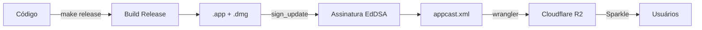

# Guia de Release — Fala

## Visão Geral

O Fala distribui atualizações fora da App Store usando **Sparkle** + **Cloudflare R2**.



### Componentes

| Componente | O que faz |
|---|---|
| `Info.plist` | Define a versão e a URL do feed |
| `appcast.xml` | Lista de versões disponíveis (hospedado no R2) |
| `Fala-X.Y.dmg` | O app empacotado (hospedado no R2) |
| EdDSA key | Par de chaves para assinar releases (no Keychain) |
| `scripts/release.sh` | Automatiza todo o fluxo |

---

## Versionamento

Seguimos [Semantic Versioning](https://semver.org/) simplificado:

```
CFBundleShortVersionString = "1.2"    ← o que o usuário vê
CFBundleVersion            = "5"      ← build number (sempre incrementa)
```

| Quando | Exemplo |
|---|---|
| Correção de bug | 1.0 → 1.0.1 (build 2) |
| Nova funcionalidade | 1.0 → 1.1 (build 3) |
| Mudança grande / breaking | 1.x → 2.0 (build N) |

> **Regra de ouro**: o `CFBundleVersion` (build) **sempre sobe**, nunca repete.

---

## Como Publicar uma Release

### 1. Bumpe a versão

Edite `Sources/Fala/Resources/Info.plist`:

```xml
<key>CFBundleShortVersionString</key>
<string>1.1</string>        <!-- versão visível -->
<key>CFBundleVersion</key>
<string>2</string>           <!-- build number -->
```

### 2. Commit da versão

```bash
git add Sources/Fala/Resources/Info.plist
git commit -m "chore: bump version to 1.1 (build 2)"
```

### 3. Publique

```bash
make release
```

Isso faz tudo automaticamente:
1. Lint + testes (preflight)
2. Build release otimizado
3. Cria `.app` bundle com Sparkle framework
4. Empacota um `.dmg`
5. Assina com a chave EdDSA
6. Gera `appcast.xml` com versão, assinatura e URL
7. Faz upload do `.dmg` e `appcast.xml` para o R2

### 4. Tag no Git (bom hábito)

```bash
git tag v1.1
git push origin main --tags
```

---

## Canais: Preciso de Beta?

### A resposta curta: **não agora**.

Para um estúdio individual, beta channels adicionam complexidade sem benefício real até você ter um grupo de beta testers. A recomendação:

| Fase do projeto | Abordagem |
|---|---|
| **Agora** (pré-launch / poucos usuários) | Canal único. Você É o beta tester. |
| **Quando tiver ~50+ usuários** | Considere um canal beta |
| **Quando tiver ~500+ usuários** | Beta + rollout gradual |

### Se/quando quiser beta

O Sparkle suporta canais nativamente. Basta adicionar `<sparkle:channel>beta</sparkle:channel>` no item do appcast:

```xml
<item>
  <title>Versão 1.2-beta1</title>
  <sparkle:channel>beta</sparkle:channel>
  <sparkle:version>10</sparkle:version>
  ...
</item>
```

Usuários no canal padrão **não veem** esse item. Só precisaria adicionar um toggle no painel de Atualizações para o usuário optar pelo canal beta. Mas isso é futuro.

---

## Onde Cada Coisa Mora

```
Fala/
├── Sources/Fala/Resources/
│   └── Info.plist              ← versão + SUFeedURL + SUPublicEDKey
├── scripts/
│   └── release.sh              ← script de publicação
├── Makefile                     ← make release / make release-dry
└── .build/artifacts/sparkle/Sparkle/bin/
    ├── generate_keys            ← gerar par de chaves EdDSA
    ├── sign_update              ← assinar um .dmg
    └── generate_appcast         ← gerar appcast (não usamos, o script gera)

Cloudflare R2 (bucket: fala-updates)
├── appcast.xml                  ← feed de atualizações
├── Fala-1.0.dmg                 ← releases
├── Fala-1.1.dmg
└── ...
```

---

## Segurança

| Item | Status |
|---|---|
| Chave EdDSA privada | ✅ No Keychain do macOS (gerada via `generate_keys`) |
| Chave EdDSA pública | ✅ Em `Info.plist` (`SUPublicEDKey`) |
| DMGs assinados | ✅ Cada release é assinada com `sign_update` |
| HTTPS | ✅ R2 serve via HTTPS |

> **⚠️ Importante**: A chave privada vive no seu Keychain. Se perder (trocar de Mac), não consegue publicar updates que o Sparkle aceite. Faça backup:
> ```bash
> .build/artifacts/sparkle/Sparkle/bin/generate_keys -p
> ```
> Esse comando exporta a chave. Guarde num lugar seguro (1Password, cofre, etc).

---

## Checklist Rápido de Release

```
□ Código testado e commitado
□ Versão bumpada em Info.plist (version + build)
□ Commit da versão
□ make release
□ Tag no git (git tag vX.Y && git push --tags)
□ Testar: abrir o app antigo → Ajustes → Atualizações → Verificar Agora
```

---

## Troubleshooting

| Problema | Solução |
|---|---|
| "Atualizações não disponíveis" | `updater` é nil — verifique se `AppDelegate` passa o updater |
| Sparkle não encontra update | Verifique se `CFBundleVersion` no appcast é **maior** que o instalado |
| Assinatura inválida | A chave pública no `Info.plist` deve ser a mesma do par que assinou |
| Upload falha | Verifique `wrangler whoami` — pode precisar `wrangler login` |
| `make release-dry` | Testa tudo sem fazer upload — use para validar |
